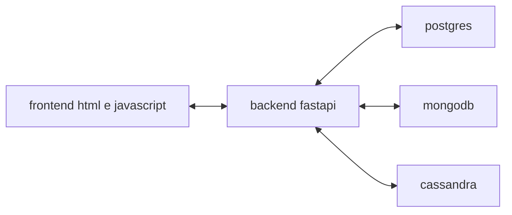

# biblioteca plural

## tema

o sistema permite cadastrar leitores e livros e controlar empréstimos de uma biblioteca. a interface permite criar, consultar, editar e excluir registros. também é possível devolver e reabrir um empréstimo.

## bancos e backend

| banco | dados | motivo da escolha |
| --- | --- | --- |
| postgres, relacional | leitores, estoque e controle das operações | as restrições evitam emails duplicados e estoque negativo. uma transação registra o empréstimo e reduz o estoque juntos. |
| mongodb, documentos | livros | cada documento guarda título, listas de autores e gêneros e campos opcionais, como isbn e ano. essas informações podem variar entre livros. |
| cassandra, colunas | histórico de empréstimos | as consultas são por leitor ou por livro. cada consulta tem sua tabela, com a chave da entidade como partição e o empréstimo como timeuuid em ordem decrescente. |



o backend é uma aplicação python com fastapi. as rotas são agrupadas em leitores, livros e empréstimos. ele recebe requisições http do frontend, valida os dados com pydantic e acessa os bancos com psycopg, pymongo e cassandra-driver. o frontend usa html, css e javascript e é servido pelo próprio backend.

### justificativa pelo teorema cap

o teorema cap trata de três garantias em um sistema distribuído:

- **consistência (c):** uma leitura observa a escrita mais recente ou falha.
- **disponibilidade (a):** toda requisição recebida por um nó que não falhou consegue ser atendida; responder apenas com erro não conta.
- **tolerância a partições (p):** o sistema considera falhas de comunicação entre os nós.

durante uma partição de rede, não é possível garantir consistência e disponibilidade ao mesmo tempo. a escolha depende do dado e da operação, conforme a [explicação de cap na documentação do cassandra](https://cassandra.apache.org/doc/stable/cassandra/architecture/guarantees.html).

| banco | relação com cap no projeto |
| --- | --- |
| postgres | o estoque precisa de um valor confiável antes de autorizar um empréstimo. se o backend perde acesso ao postgres, ele recusa a operação em vez de continuar com uma cópia local desatualizada. a aplicação prioriza a correção do estoque e aceita ficar indisponível para empréstimos. |
| mongodb | o catálogo usa documentos e, em um replica set, as escritas passam pelo primário. durante uma eleição, as escritas ficam indisponíveis até haver um novo primário. para priorizar a confirmação das escritas entre réplicas, a url de exemplo usa `w=majority`. essa garantia depende da configuração usada em `MONGO_URL`; o código não impõe esse parâmetro. |
| cassandra | o histórico pode aceitar atraso nas atualizações. sua arquitetura favorece disponibilidade e tolerância a partições, normalmente descrita como ap. a consistência é ajustável por operação: exigir mais réplicas pode reduzir a disponibilidade. isso combina com consultas de histórico que não decidem se há estoque para um novo empréstimo. |

no mongodb, [escritas por maioria](https://www.mongodb.com/docs/manual/reference/write-concern/) e [eleições de primário](https://www.mongodb.com/docs/manual/core/replica-set-primary/) explicam a perda temporária de disponibilidade. `w=majority` sozinho não garante que toda leitura seja linearizável; as garantias também dependem das opções de leitura. no cassandra, os [níveis de consistência](https://cassandra.apache.org/doc/stable/cassandra/architecture/dynamo.html#tunable-consistency) permitem ajustar quantas réplicas precisam responder.

o postgres não deve ser classificado automaticamente como ca por ser relacional. o projeto não configura sua replicação; essa parte depende do serviço contratado. a documentação do postgres descreve como a [replicação síncrona](https://www.postgresql.org/docs/current/warm-standby.html#SYNCHRONOUS-REPLICATION) pode fazer uma confirmação esperar pelas réplicas. as restrições e a transação usadas aqui são garantias de integridade e atomicidade, não uma prova de consistência no sentido de cap.

na aplicação, o empréstimo pode ser concluído com postgres e mongodb acessíveis mesmo que o cassandra esteja fora do ar. o histórico fica pendente e é atualizado após uma nova tentativa de sincronização. essa é uma decisão de consistência eventual entre bancos, separada da replicação interna de cada banco. ela não significa que o sistema inteiro garante disponibilidade: sem acesso ao postgres, novos empréstimos continuam bloqueados.

### operações

| recurso | criar | consultar | editar | excluir |
| --- | --- | --- | --- | --- |
| leitores | `post /api/usuarios` | `get /api/usuarios` | `put /api/usuarios/{id}` | `delete /api/usuarios/{id}` |
| livros | `post /api/livros` | `get /api/livros` | `put /api/livros/{id}` | `delete /api/livros/{id}` |
| empréstimos | `post /api/emprestimos` | `get /api/emprestimos` | `put /api/emprestimos/{id}` | `delete /api/emprestimos/{id}` |

na edição de um empréstimo, o campo `devolvido` controla a devolução ou reabertura. leitores e livros com empréstimos vinculados não podem ser excluídos; primeiro é necessário excluir esses empréstimos.

o histórico é lido diretamente do cassandra em `get /api/historico/usuarios/{id}` e `get /api/historico/livros/{id}`. a documentação interativa em `/docs` organiza as rotas por recurso e permite testar as consultas. as listagens de livros, empréstimos e histórico retornam até 200 registros.

### atualização entre bancos

a operação de empréstimo é registrada no postgres junto com a mudança no estoque. depois, o backend envia o histórico às duas tabelas do cassandra. se ele estiver indisponível, o registro fica pendente no postgres. o botão **atualizar histórico** tenta novamente. a mesma regra vale para devoluções e exclusões; exclusões pendentes ficam na tabela `emprestimos_excluidos`.

as atualizações usam a mesma chave, permitindo repetir uma sincronização parcial. o backend usa um lock no postgres para serializar as alterações no histórico. cada sincronização processa até 100 atualizações e 100 exclusões.

não existe transação distribuída entre os três bancos. uma interrupção entre uma escrita no mongodb e outra no postgres pode exigir ajuste manual do catálogo ou estoque.

## executar do zero

### serviços necessários

- python 3.14 e pip ou uv.
- um banco postgres, por exemplo no neon.
- um cluster mongodb, por exemplo no atlas.
- um banco cassandra no astra db, com acesso pelo driver cql e arquivo de conexão segura.

crie os serviços antes de executar o projeto. no postgres, crie um banco vazio e obtenha a url de conexão. no mongodb, crie um usuário com permissão de leitura e escrita no banco `biblioteca`. os dois serviços precisam permitir conexões da máquina que executará a aplicação.

no astra, crie o keyspace `biblioteca`, gere um token com permissão para criar tabelas e ler e escrever os dados, e baixe o arquivo de conexão segura. esse arquivo é necessário para o driver cql usado no projeto. um endpoint da data api não substitui o arquivo.

### configuração

na raiz deste repositório:

```bash
python3.14 -m venv .venv
source .venv/bin/activate
pip install -r requirements.txt
cp .env.example .env
```

no windows, ative o ambiente com `.venv\Scripts\activate` e copie `.env.example` para `.env` pelo explorador ou terminal.

preencha as seguintes variáveis no `.env`:

| variável | valor |
| --- | --- |
| `POSTGRES_URL` | url do banco postgres; no neon, mantenha `sslmode=require` |
| `MONGO_URL` | url do cluster mongodb com usuário e senha |
| `ASTRA_BUNDLE_PATH` | caminho do arquivo de conexão segura, relativo à raiz do projeto ou absoluto |
| `ASTRA_TOKEN` | token do astra |
| `ASTRA_KEYSPACE` | nome do keyspace criado, por exemplo `biblioteca` |

não versione o `.env` nem o arquivo de conexão segura. eles já estão no `.gitignore` para o padrão `secure-connect-*.zip`.

### preparar os bancos e iniciar

```bash
python cloud/setup_cloud.py
python -m uvicorn app:app --app-dir src --reload
```

o script cria as tabelas relacionais, a coleção de livros com validação e índices e as duas tabelas do cassandra. pode ser executado novamente sem apagar os dados existentes. o keyspace do astra precisa ter sido criado antes, pois sua configuração é feita pelo serviço.

abra `http://localhost:8000` e cadastre um leitor e um livro com pelo menos um exemplar. depois registre um empréstimo e teste a devolução. a aplicação começa sem dados e não depende de cadastros prévios.

com uv, use `uv sync` para instalar as dependências e `uv run python` no lugar de `python`. para atualizar somente o esquema relacional de uma instalação existente, use `PYTHONPATH=src uv run alembic upgrade head` ou execute novamente o script de preparação.

## arquivos

- `src/app.py`: aplicação e arquivos do frontend.
- `src/router.py`: rotas de leitores, livros e empréstimos.
- `src/database.py`: conexões com os três bancos.
- `src/schemas/`: validação dos cadastros.
- `src/static/`: frontend.
- `db/`: esquemas dos bancos.
- `cloud/setup_cloud.py`: preparação dos serviços.
- `src/migrations/`: migrações relacionais.
- `tests/`: testes locais das regras e da api.

## testes

```bash
pip install -r requirements-dev.txt
PYTHONPATH=src python -m unittest discover -s tests -v
```

com uv: `uv run python -m unittest discover -s tests -v`, com `PYTHONPATH=src` definido no ambiente. os testes usam sqlite e substitutos para mongodb e cassandra, sem alterar os dados em nuvem.

## limites

esta é uma aplicação acadêmica de administração, sem autenticação. execute localmente ou em uma rede de acesso restrito.

na validação anterior, postgres e mongodb conectaram. o cassandra ainda precisa ser validado com o arquivo indicado em `ASTRA_BUNDLE_PATH`, ausente naquele momento. os testes locais não substituem essa verificação com os três serviços.
